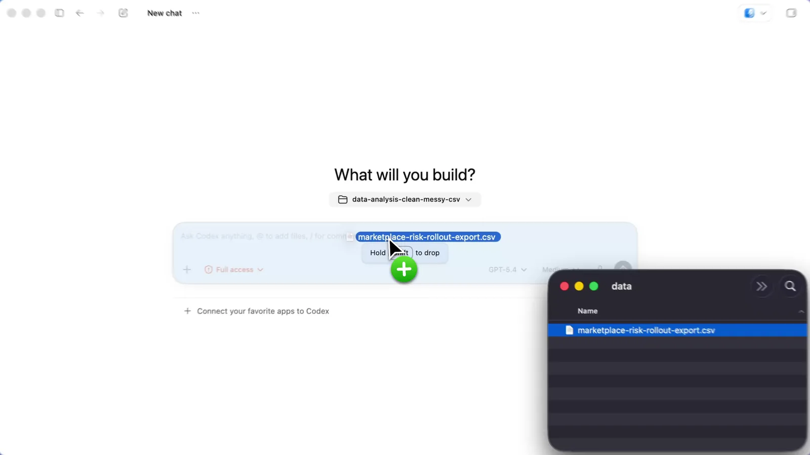
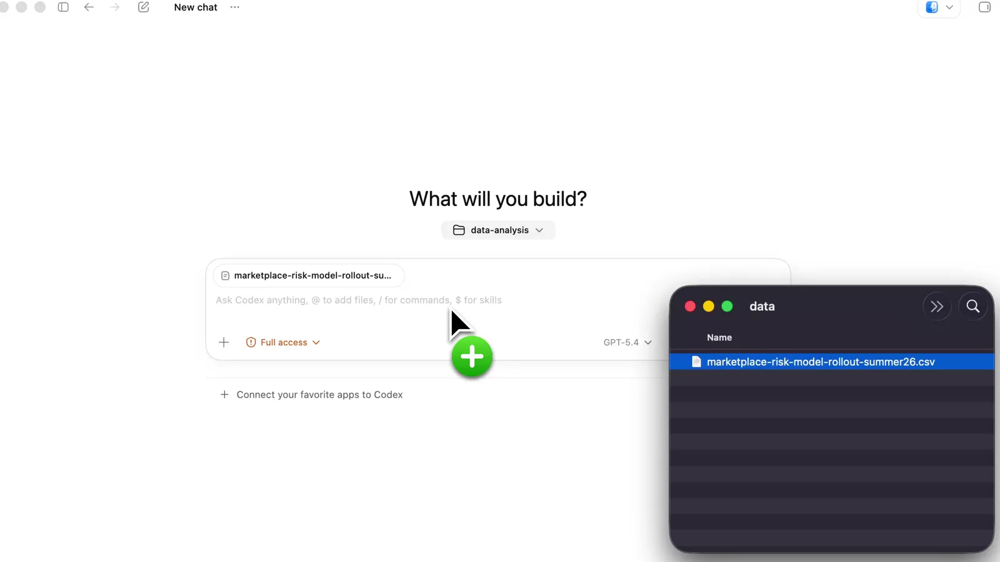
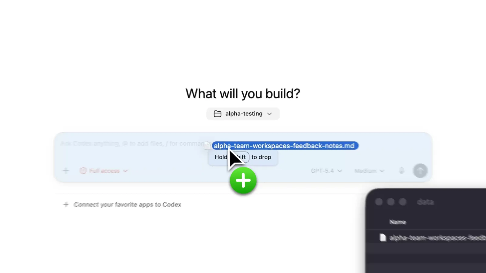
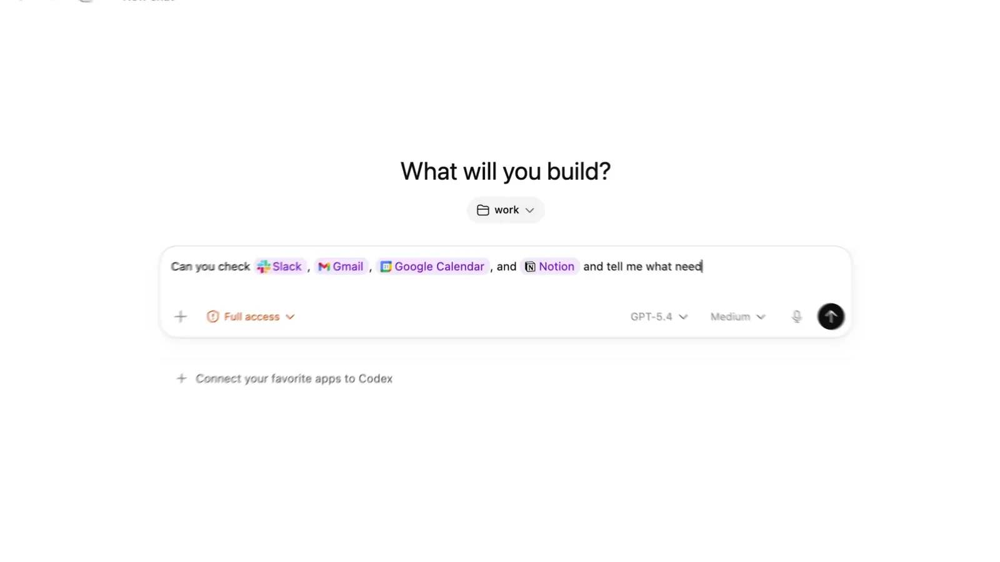
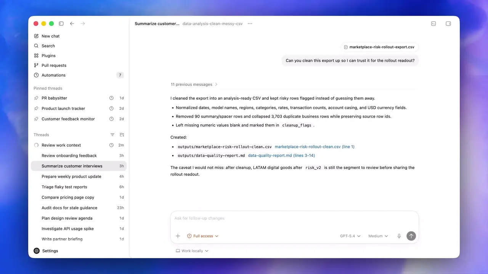
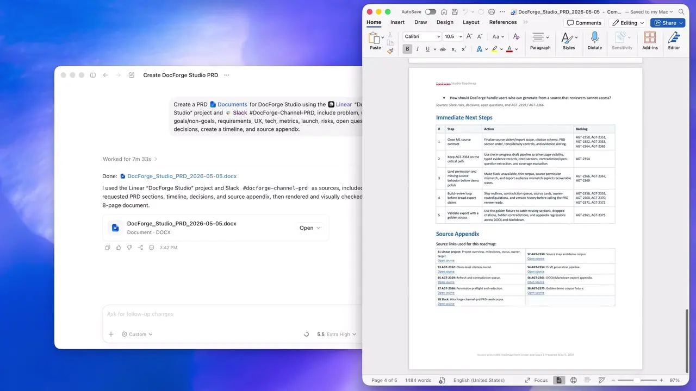
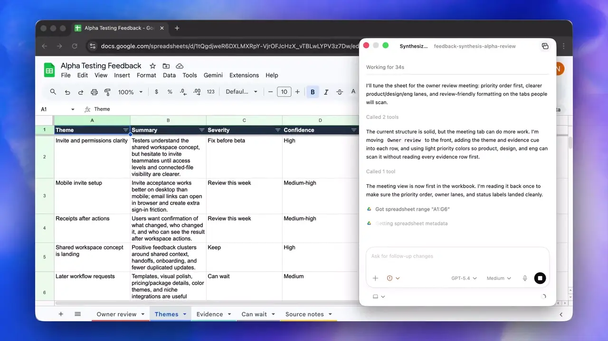

# 22. Desktop reference library — 2026-11-04

## Evidence and limits

Primary layout target: the user-supplied `image-1.png` at `/home/han/.codex/attachments/aae2839a-7d55-417e-972f-c6c00783c6f7/image-1.png`. It shows the dark Windows ChatGPT workspace with a persistent icon rail, a separate project/history sidebar, a centered conversation, a bottom composer, and a right context card. The image remains outside version control because it contains personal conversation titles.

This library supplements documents 01 and 21; their historical claims are not a substitute for current screenshot evidence. In particular, document 21's “one sidebar” target does not match the newly supplied two-column left navigation. Restore the persistent icon rail and keep sidebar expansion separately controllable.

Official source retrieved: [Codex app documentation](https://developers.openai.com/codex/app/). Five actual official demonstration poster images and three later video frames are retained below, with source URLs, byte counts and SHA-256 in [sources.json](references/sources.json). These are reference-only OpenAI images, not Orchester branding or distributable application assets. They are cropped demonstration frames, not evidence of every full desktop window state.

The search service returned HTTP 404. OpenAI marketing, ChatGPT desktop landing page and Windows/macOS help pages returned HTTP 403; the developer documentation was accessible. No claim is made to have collected every screenshot or version. Settings, open model dropdown and mobile layouts still lack captured visual evidence. Later frames below establish light macOS-style full-window chrome.

## Screenshot inventory

### data analysis cleaning csv

[Original image](https://developers.openai.com/images/codex/video-posters/data-analysis-cleaning-csv.webp) · [source page](https://developers.openai.com/codex/app/)

### data analysis fraud spike

[Original image](https://developers.openai.com/images/codex/video-posters/data-analysis-fraud-spike.webp) · [source page](https://developers.openai.com/codex/app/)

### draft prds from slack linear docs

[Original image](https://developers.openai.com/images/codex/video-posters/draft-prds-from-slack-linear-docs.webp) · [source page](https://developers.openai.com/codex/app/)

### feedback synthesis into gsheets

[Original image](https://developers.openai.com/images/codex/video-posters/feedback-synthesis-into-gsheets.webp) · [source page](https://developers.openai.com/codex/app/)

### proactive teammate v2

[Original image](https://developers.openai.com/images/codex/video-posters/proactive-teammate-v2.webp) · [source page](https://developers.openai.com/codex/app/)

## Surface coverage and implementation guidance

| Surface | Evidence | What to follow / missing evidence |
| --- | --- | --- |
| Home | proactive teammate poster | Greeting and composer form one centered block; workspace selector above input. |
| Icon rail | User screenshot | Always-visible destination icons; sidebar collapse must not remove navigation. |
| History / pinned / projects | User screenshot | Compact grouped rows, independent long-list scrolling, muted labels, restrained selected background. |
| Conversation | User screenshot | Readable narrow column, generous exterior space, muted inline tool activity, neutral content surfaces. |
| Composer | User screenshot + official posters | Rounded surface, multiline text above compact tool row; permission left, model/microphone/send right. |
| Model menu | Closed trigger visible in screenshot/posters | Do not infer open dropdown structure; validate actual provider/model interaction separately. |
| Tools / output | User screenshot | Inline progress and expandable source result card; no oversized decorative status tiles. |
| Inspector | User screenshot | Distinct right contextual surface without covering composer or conversation. |
| Settings | [Official settings documentation](https://developers.openai.com/codex/app/settings/) | Text reference retrieved; no settings screenshot retained. |
| Review | [Official review documentation](https://developers.openai.com/codex/app/review/) | Text reference retrieved; no full review screenshot retained. |
| Worktrees | [Official worktrees documentation](https://developers.openai.com/codex/app/worktrees/) | Text reference retrieved; no worktree picker screenshot retained. |
| Light theme | Official posters | Light neutral composer and dark send button; posters do not establish full-shell colors. |
| Dark theme | User screenshot | Near-black transcript, slightly lighter sidebar, raised gray composer/context cards. |
| Resize / motion | No temporal evidence from static image | Verify behavior in browser; do not claim a screenshot proves smoothness. |

## Supplied screenshot measurements

Approximate image-space measurements from the displayed 2048 × 1099 reference (not CSS pixel requirements; OS scaling is unknown): icon rail 39 px, sidebar from x≈39 to 216, title chrome 33 px high, conversation/composer x≈857–1406 (549 px wide), right context card x≈1815–2040. Main conversation area is visibly darker than the composer; sidebar labels are muted, and accent is limited to permissions/send/status. These proportions support a fixed-width left rail and sidebar with a flexible center and optional inspector, not proportional shrinking of the sidebar to zero.

Implementation inference: keep existing product font/icon assets, readable CSS text sizes and design tokens rather than blindly copying screenshot raster dimensions. Animate only short intentional transitions, disable motion for reduced-motion preference, and avoid forced smooth scrolling while a reader browses older messages. Test populated and empty history, collapsed/reopened navigation, narrow windows, inspector opening, refresh persistence and keyboard access. This paragraph is a proposed acceptance policy, not a claim that official app internals were inspected.

## Expanded full-window and output references

The official demo video sources are embedded in the same app documentation. Frames below were extracted at 20 seconds from the 720p rendition using FFmpeg, without layout reconstruction. The timestamp and source CDN URL are recorded in the manifest. Video names describe source URLs, not independently verified product/version labels.

| Frame | Observed visual coverage |
| --- | --- |
| proactive-teammate-v2, 20 s | Complete light desktop window: traffic-light controls, pinned threads, history, search/plugins/automations, settings footer, transcript, composer. |
| draft-prds-from-slack-linear-docs, 20 s | Desktop conversation with generated document attachment and document open in an external app. |
| feedback-synthesis-into-gsheets, 20 s | Narrow floating conversation alongside browser spreadsheet; working state, tool activity and stop control. |

[Official video](https://cdn.openai.com/devhub/videos-learn/proactive-teammate-v2-720p-v1.mp4) — 00:20

[Official video](https://cdn.openai.com/devhub/videos-learn/draft-prds-from-slack-linear-docs-720p-v1.mp4) — 00:20

[Official video](https://cdn.openai.com/devhub/videos-learn/feedback-synthesis-into-gsheets-720p-v1.mp4) — 00:20

### Additional retrieval audit

Repeated browser-user-agent requests to [Codex launch](https://openai.com/index/introducing-the-codex-app/), [ChatGPT Windows](https://help.openai.com/en/articles/9982051-using-the-chatgpt-windows-app), [ChatGPT macOS](https://help.openai.com/en/articles/9275200-using-the-chatgpt-macos-app), and [ChatGPT desktop](https://chatgpt.com/features/desktop/) returned HTTP 403. These are discovery links, not inspected visual evidence. The accessible features/review/settings pages expose decorative wallpaper and icons but no full-screen reference images; those decorative assets were intentionally excluded. The official `openai/codex` GitHub tree contains a CLI splash and skill icons, not desktop screenshots, so it cannot fill these gaps. Windows dark full-window evidence remains the user-supplied screenshot; separate current ChatGPT macOS/Windows help screenshots and full review/settings screens remain to collect when accessible.
