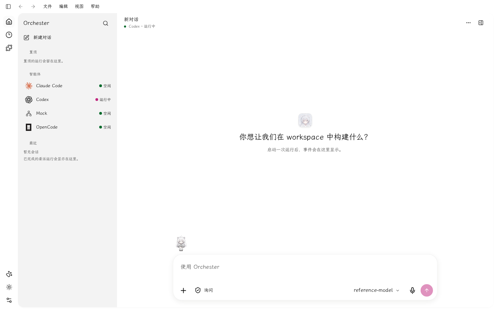
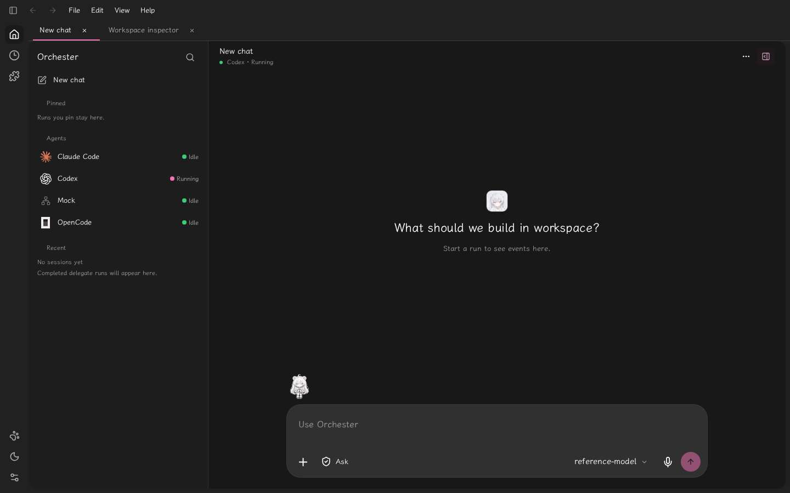
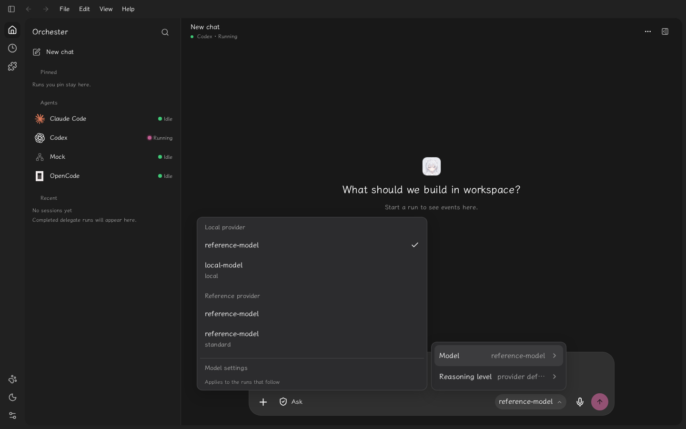
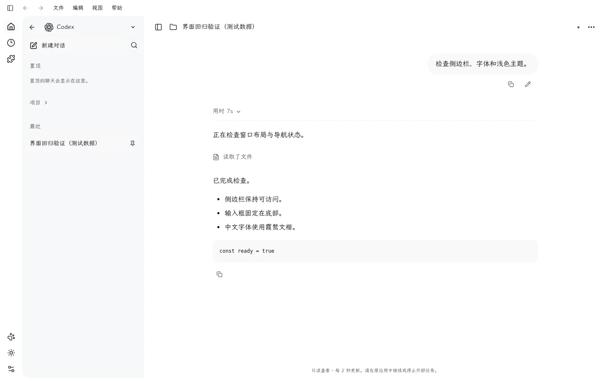
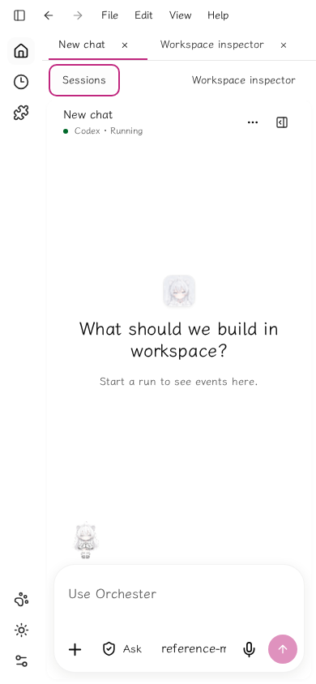

# 23. Desktop navigation recovery and reference alignment

Verified on 2026-11-04 against the supplied dark ChatGPT screenshot and the newer light Codex home screenshot (`907ebe8c…/image-5.png`). The newer image supersedes document21's single-column navigation assumption and its centered-composer placement. CLI task-center acceptance is recorded separately when its implementation is verified.

## Result and reference mapping

| Requirement | Implemented behavior | Evidence |
| --- | --- | --- |
| Icon rail and session sidebar | Global destinations remain visible when the session sidebar is collapsed, reloaded or replaced by a drawer. Product title and search sit above the conversation list. | `88db30e`, `ba9c789`; actual browser collapse/reload/search/route checks |
| Responsive content | Mobile transcript occupies the only active grid track, including persisted folded state. Tested at390,799,800,1024,1440px. | `068e3bf`; browser bounding boxes and no viewport overflow |
| Smooth panel behavior | Pointer resizing uses movement deltas, with no52px jump. Collapse uses the shared340ms curve, retains sidebar state and makes folded contents inert. Reduced motion is at most1ms. | `76f25d7`, `068e3bf`; real pointer and reduced-motion checks |
| Reference home layout | Greeting names the selected workspace and centers above a bottom-anchored composer. Dark transcript is below raised composer surfaces; light composer has a subtle boundary and shadow. | `ba9c789`, `522a2c0`; dark/light captures |
| Blog typography and motion | Local LXGW WenKai WOFF2 and classic160/220/340ms motion, with user overrides and code monospace retained. Browser loaded the font and rendered Chinese. | `8a36853`, `3316f68`; [font provenance](../../packages/design/src/fonts/README.md) |
| Supplied artwork | Web mark is the supplied1254px PNG; favicon, touch icon,512px PNG and native ICO derive from the same file. | `522a2c0`; source SHA-256 `73a86d4d31c1a41216a1467e9710691dc5f548dddf66067a9e3dabe25f565e6b` |
| Provider menu | Selecting Local via the menu updates the real backend catalog's selected provider. Menus, inspector, search, settings, plugins and schedules respond. | Browser interaction sweep; no model network request required |
| Theme startup | Saved appearance is applied by a blocking same-origin script accepted by the desktop content policy, before the app renders. | `1d37b83`; build-output test and real EmbeddedServer |
| Conversation styling | Agent text, tool rows, user messages, attachment controls and menu surfaces use theme roles; spacing migration no longer fails the design gate. | `0bd04df`;303 design tests and fixture conversation captures |

The local Windows blog directory was unavailable. The exact public repository source was inspected at commit89531e0; font license, conversion verification and motion provenance are in [the bundled font documentation](../../packages/design/src/fonts/README.md). User-supplied personal reference screenshots remain outside version control. Official visual references and retrieval limits are in [22-desktop-reference-library.md](22-desktop-reference-library.md).

## Verification environment

Browser plugin was unavailable; regular Playwright Chromium drove the actual production web build served through `orchester-netz`'s `management_preview` EmbeddedServer, with its real fragment-token/cookie/CSRF boundary. Provider fixtures use an isolated home with private permissions and a loopback non-serving endpoint; no production API keys or user configuration were changed.

Desktop and mobile interaction sweep:27 assertions passed, including page identity, meaningful content, sidebar reload persistence, focus return, pointer resize, provider persistence, inspector, routes, drawer open/close, responsive geometry, font load and reduced motion. No framework overlay or JavaScript page errors occurred. Chromium logs the existing unsupported `navigate-to` CSP directive; the inline-script CSP failure was fixed without relaxing policy.

The agent conversation screenshots use explicitly labeled test data at the activity API boundary to inspect Chinese text, neutral user messages, tool rows and code in both themes. They verify frontend rendering, not external-provider connectivity. The native Windows window and installer were not launched in this Linux session; native icon/configuration contracts were checked and source assets updated. No installation claim is made.

Commands checked: `pnpm --filter @orchester/web build`, `pnpm typecheck`, `pnpm stack:verify`, `pnpm test`. Final workspace run passed: Web732, design303, protocol89, events28, website31, tooling and desktop contract tests. One earlier provider-settings assertion failed transiently; focused5/5 and two subsequent full Web runs passed unchanged, including the final workspace gate.

Raw scripts, assertions, captures and logs remain in the ignored `.orchester-qa/` folder. The selected screenshots below are retained so visual evidence survives temporary-process cleanup.

## Captures

### Light home, Chinese and the requested font

### Dark workspace

### Model/provider selection

### Conversation rendering with test data

### Mobile workspace

