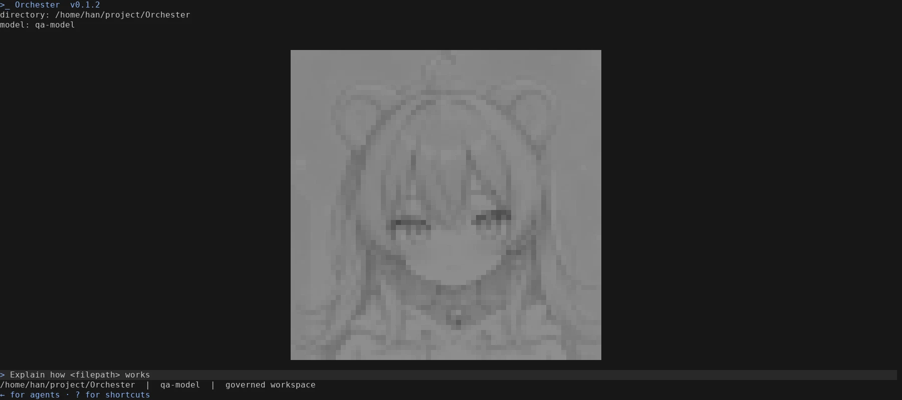
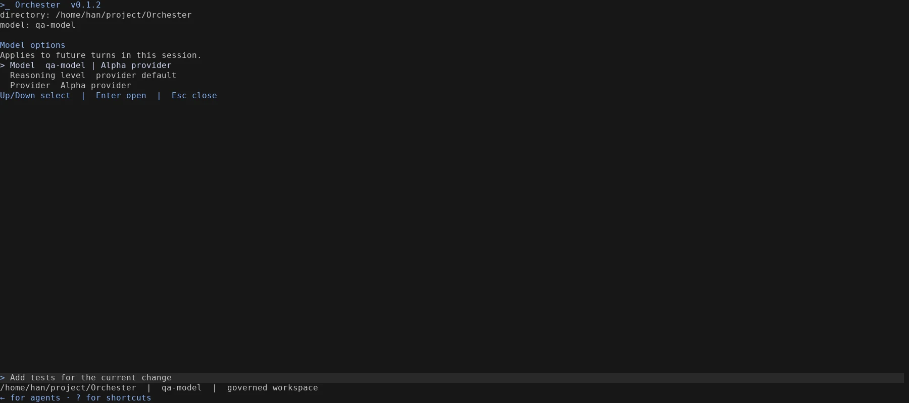
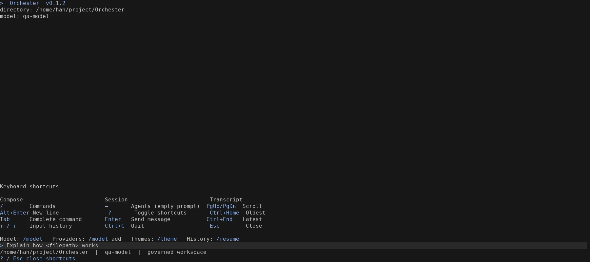
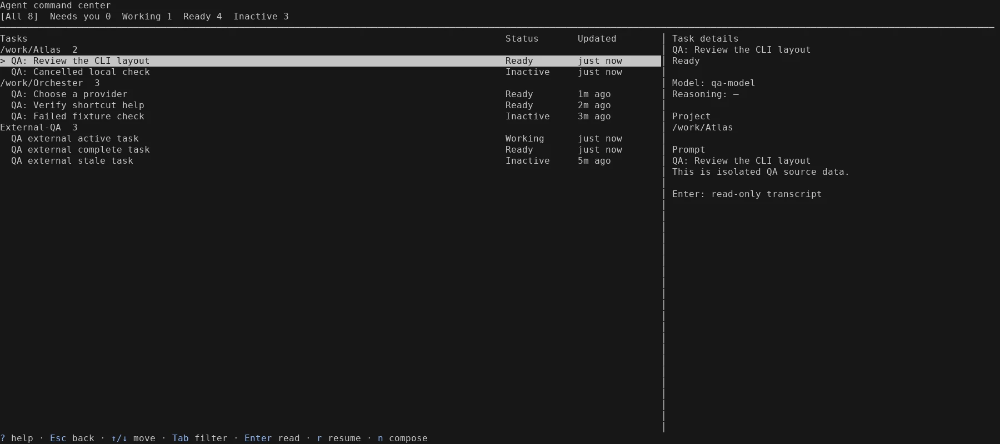
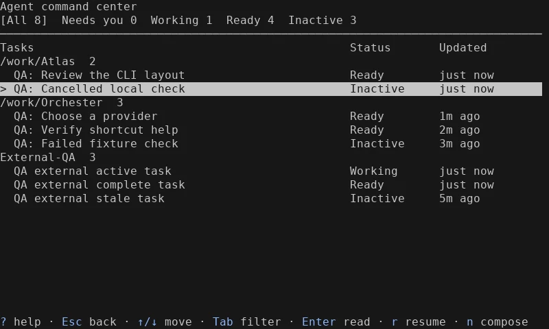

# CLI 全屏布局与任务中心验收

本轮对应用户提供的 `907ebe8c…/image-1.png` 至 `image-4.png`。实现沿用 Rust CLI，不改变产品版本。

## 布局与操作

- 启动占满终端：目录、模型信息位于顶部，输入区和状态提示位于底部，中间显示指定 PNG 转换的 ANSI 半块图像。图像随可用空间缩小，窄窗口优先保留输入与状态。
- 空草稿时 `?` 打开分组快捷键说明；普通输入和粘贴中的问号仍是文本。多行草稿、Unicode 输入、滚动和终端恢复沿用现有行为。
- `/model` 和 `\model` 打开 Model、Reasoning level、Provider 三个独立选项。Provider 子菜单列出实际配置的供应商，切换后重新打开菜单可以看到当前会话的选择；模型与推理强度保持原有独立选择规则。
- 空草稿时 `←` 打开 Agent command center。`Tab` / `Shift+Tab` 切换状态，方向键选择任务，`Enter` 查看记录，`r` 续跑支持恢复的 Orchester 任务，`n` 返回输入区，`Esc` 返回。`/agent` 继续用于选择委派执行器。
- 任务列表按项目分组，显示状态与更新时间；宽终端展示右侧详情，窄终端通过 Enter 阅读详情。来源扫描在后台执行，刷新保留选中任务；部分来源不可读时显示警告并保留其余任务。

## 数据含义

任务来自实际的本地运行记录、当前工作区的受管恢复目录，以及现有 Codex、Claude、OpenCode 活动读取器。测试中使用隔离的真实格式文件；产品没有硬编码演示任务。

外部会话只读，详情展示读取器提供的转录片段。Working 来自近期记录中的活动状态，过期的活动状态归为 Inactive。Needs you 对应受管运行的审批或人工协调要求。Ready 可以表示已完成的记录或允许继续的运行；只有恢复目录提供可用 opaque handle 的任务才响应 `r`，恢复时仍执行现有 owner、工作区与状态校验。

原始记录没有提供的模型、推理强度、提示或时间显示为 `—`。外部摘要的项目名称保留来源信息；不会用当前 CLI 配置冒充历史任务配置。受管恢复目录沿用原有凭据解析和数据库访问流程。

项目身份与显示名称分离：本地使用原始路径，外部使用来源项目标识；缺少外部项目身份时按会话分别显示。同名目录不会因此被合并为一个项目。

指定图像来自 `C:\Users\han\picture\Orchester.png`，转换过程与 [资源说明](../../kisten/konsole/src/interactive/assets/README.md) 一致。桌面端字体、导航、动画和浏览器交互见 [桌面端验收](23-desktop-recovery-acceptance.md)。

## 验证方式

Linux PTY 驱动实际构建的 `target/debug/orchester`，覆盖 180 × 40、80 × 24 和 40 × 14。隔离配置使用非服务端点，没有调用真实模型服务，也没有修改用户 Windows 配置。

任务中心检查包含真实格式历史与外部记录读取、状态筛选、反向切换、选中变化、多行提示、只读详情、滚动到底后立即向上、窄屏详情、窄屏当前筛选可见、返回首页和光标恢复。模型菜单检查实际完成 Alpha → Beta provider 切换并重新打开确认；另行检查字面量 `\model`、普通问号快捷键和 bracketed paste 问号。

最终验证：

| 检查 | 结果 |
| --- | --- |
| `cargo test -p orchester-konsole` | 268 项通过 |
| `cargo clippy -p orchester-konsole --all-targets -- -D warnings` | 通过，无警告 |
| `cargo build -p orchester-konsole` | 通过 |
| `cargo test -p orchester-netz --features static-files --no-fail-fast` | 177 项通过，1 项原有忽略 |
| 实际任务中心 PTY | 22 项检查通过，含来源读取失败时仍保留可读任务 |
| Provider 与输入回归 | Provider 切换、`\model`、问号与粘贴、退出恢复均通过 |

关键提交：`e4be76d` Provider 入口、`e6ca66e` 全屏首页、`0372fca` 任务中心、`184850c` 项目身份分组。后端模型路由测试发现已有测试目录权限不符合配置要求，`b369d7b` 修正测试目录权限，未放宽断言或生产校验。

终端图像由实际 PTY 输出通过终端模拟器重建，使用固定字体展示；它们不是 Windows Terminal 原生截图。原始脚本、ANSI 记录及断言保留在忽略目录 `.orchester-qa/`。本轮没有运行 Windows 原生安装包验收。

## 终端记录

### 全屏首页

### 模型和 Provider 入口

### 快捷键说明

### Agent command center：隔离测试任务

### 窄终端

