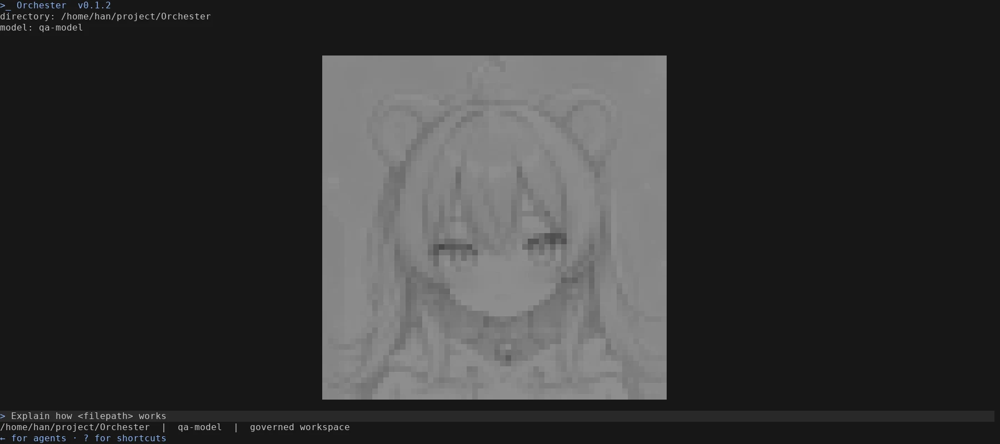
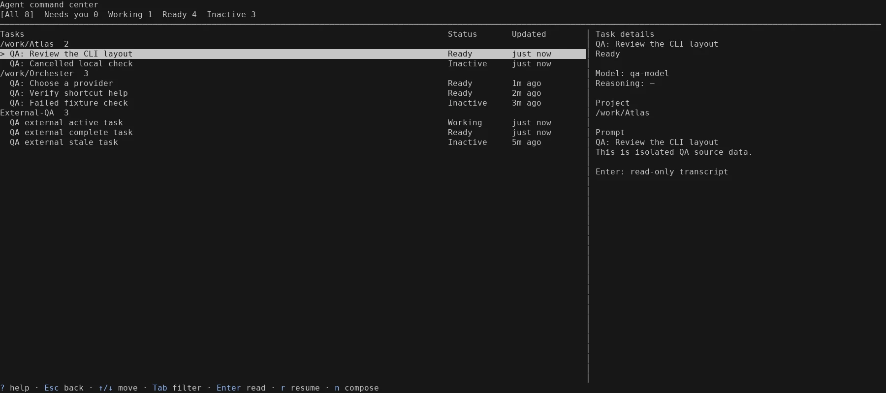
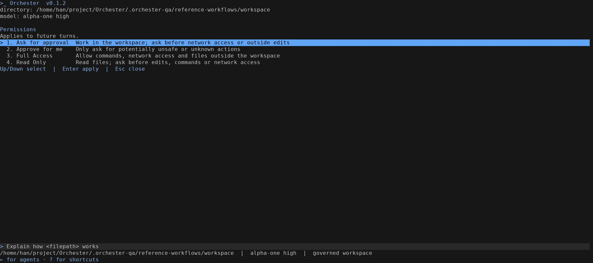
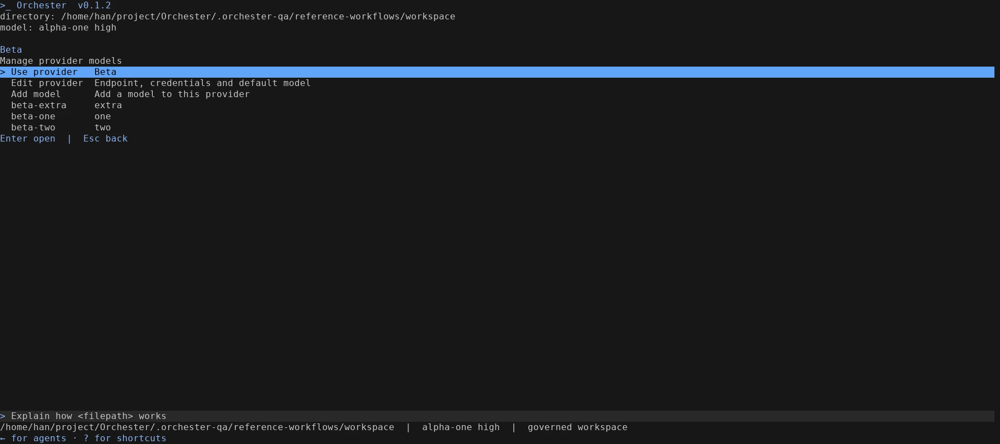
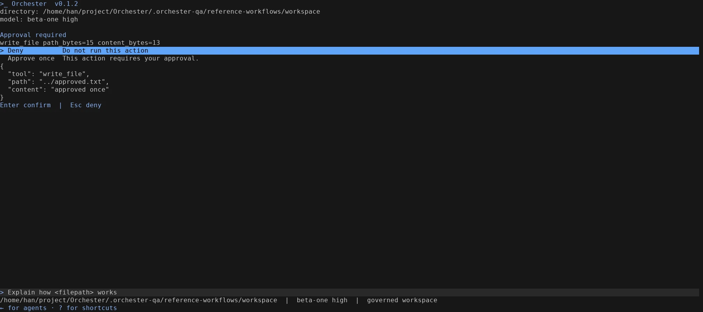
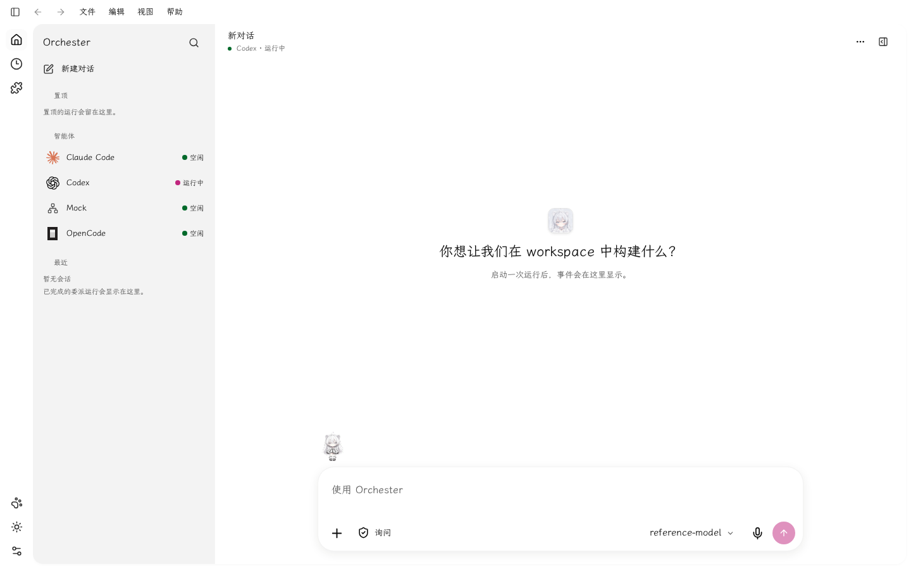
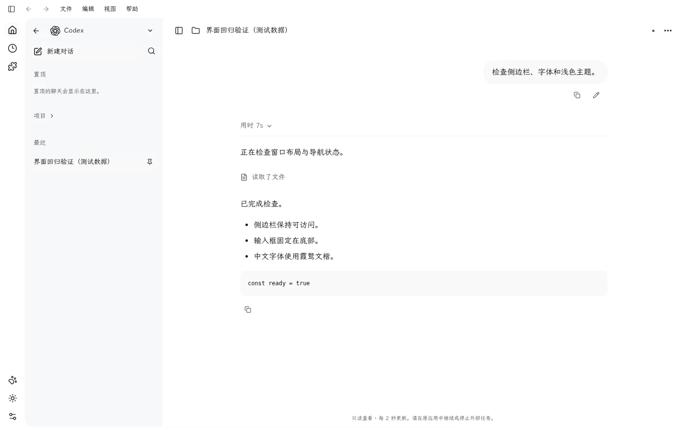

# CLI 与桌面应用参考图验收

本轮按用户提供的命令菜单、四档权限、彩色任务中心和 ChatGPT 桌面布局参考图调整。

## CLI

- Slash 菜单位于输入框上方，选中项整行蓝底黑字，命令和描述分列；通用选项沿用整行选中样式。
- 任务标题按稳定任务 ID 使用紫、粉、绿、青、蓝配色，状态圆点单独着色。选中行蓝底黑字，右侧标题保持该任务颜色；项目身份、分组和真实数据来源保持原有语义。
- 中央原图资源提高到 256 × 256，180 × 40 终端实际显示 62 × 62 像素，显示上限为 128 × 128。亮度压到 24–144，所有像素保持中性灰，完整保留原图构图。
- `/model → Provider settings` 管理提供商及其模型。每个模型占一行，进入后可使用、编辑和删除；新增别名按提供商隔离，不同提供商可以使用相同别名。模型切换限定在对应提供商目录中，保留独立推理选择。
- `/permissions` 提供 Ask for approval、Approve for me、Full Access、Read Only 四档。选择写入用户配置，下一轮重建运行时；未选择过模式的旧配置保留原有策略。
- 需要审批的动作展示脱敏内容，提供 Deny 和 Approve once。批准通过持久化、单次、绑定动作的授权执行并继续原运行；拒绝不执行。批准一次不会改变全局权限。写入及补丁等待修改锁时响应取消。

现有工具边界仍然适用：`RunChecks` 尚无配置执行器；补丁解析器不接收绝对路径头，外部补丁可使用 `../` 相对路径。

## GUI

保留图标导航，采用浅灰侧栏、白色阅读区和居中 52rem 内容宽度。空输入框为底部单行圆角框，输入后展开，附件、权限、模型、语音和发送功能保持可用。继续使用已有霞鹜文楷字体及原图资源。

## 验证

- Laufzeit、Anwendung、Konsole 完整回归 909 项通过；之后补充的取消等待锁测试通过。严格 Clippy 通过。
- Netz 含静态资源功能的回归通过。
- Web 732 项测试、typecheck、build 通过。浏览器检查桌面和移动尺寸、输入及清空；另以实际本地服务加载新版资源，检查中文浅色界面及隔离会话示例，无页面异常。
- 实际 CLI PTY 检查四档权限保存、跨提供商相同别名、模型添加/编辑/删除、模型选择范围、等待审批时不写入、批准后原运行继续、拒绝不写入，以及模式保持不变；12 项检查全部通过。
- 任务中心 22 项 PTY 检查通过，覆盖真实格式记录、过滤、详情、滚动、窄窗口、来源读取失败与光标恢复。
- 原始 ANSI、浏览器记录和安装凭据保留在忽略目录 `.orchester-qa/`；终端图由真实 PTY 输出重建，非 Windows Terminal 原生截图。会话截图中的内容为明确标注的隔离测试数据。

## 视觉记录

