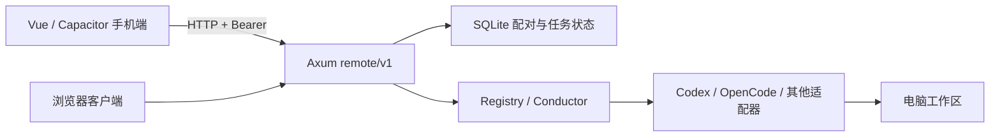

# 远程控制：架构与本地部署

手机保存一台或多台电脑的地址，通过一次性配对码获得访问令牌，然后选择该电脑上的真实项目目录，启动、查看、停止及续接 Claude、Codex、OpenCode 等外部 Agent。模型登录、CLI 安装、文件修改和进程执行均在电脑完成。Android 与 iOS 共用 Vue 客户端，浏览器也可访问同一界面。

## 技术栈与目录



| 路径 | 职责 |
| --- | --- |
| `kisten/konsole/src/remote.rs` | 监听地址、静态资源、精确 CORS、本机管理命令和退出 |
| `kisten/netz/src/remote/mod.rs` | API 路由、鉴权、SQLite 状态、单服务实例锁 |
| `kisten/netz/src/remote/auth.rs` | 一次性配对与设备撤销 |
| `kisten/netz/src/remote/projects.rs` | 持久化项目目录、允许根目录内的文件/目录分页浏览 |
| `kisten/netz/src/remote/runs.rs` | 任务提交、分页输出、停止、删除与续接 |
| `kisten/adapter`、`kisten/vertrag`、`manifeste` | Agent 能力、命令参数和事件协议适配 |
| `apps/mobile/src/App.vue` | 设备、配对、任务与输出界面 |
| `apps/mobile/src/client.ts` | 地址校验、原生 HTTP / 浏览器 fetch、认证与幂等键 |
| `apps/mobile/src/credentials.ts` | 原生凭据插件与浏览器内存凭据接口 |
| `apps/mobile/android`、`apps/mobile/ios` | 原生安装工程与 Keystore / Keychain 实现 |
| `werkzeug/mobile` | Android 工具链选择与 APK 构建脚本 |
| `werkzeug/remote` | Linux / Windows 启动、受限防火墙配置与真实 CLI 验收脚本 |
| `kisten/vertrag/src/process` | 跨平台命令解析、Windows npm 启动脚本解析与进程树生命周期 |
| `docs/remote.openapi.yaml` | 可供新客户端复用的版本化接口契约 |

后端复用 Rust、Tokio、Axum、SQLite 和现有委托运行时；手机端采用 Vue 3、TypeScript、Vite、Capacitor 8。原生 HTTP 允许访问用户选择的局域网地址；浏览器按同源或显式 CORS 规则连接。服务只挂载远程路由，电脑原有本地 cookie API 不随之开放。

原生请求使用 [CapacitorHttp.request](https://github.com/ionic-team/capacitor/blob/8.6.0/core/http.md)，不依赖浏览器跨源 cookie。构建锁定版本，升级原生依赖后应重新运行安装后的桥接测试。

## 电脑部署

已安装仓库依赖时，Linux / macOS 可直接从任意目录调用：

```sh
bash werkzeug/remote/start.sh --workspace /absolute/path/to/project --allow-root /absolute/path/to/projects --bind 0.0.0.0 --port 7337
```

脚本构建当前 UI 和本机架构的 CLI，并在同一终端显示配对码、接收 `pair` / `devices` / `quit` 管理命令。构建产物是 `target/<本机 Rust host>/debug/orchester`（尊重 `CARGO_TARGET_DIR`），状态默认位于 `${XDG_STATE_HOME:-~/.local/state}/orchester-remote`。这是前台服务，关闭终端或重启系统后需重新启动，尚未安装系统级自启服务。

Windows 原生启动脚本需要已构建的手机页面、Rust MSVC 工具链：

```powershell
pnpm --filter @orchester/mobile build
.\werkzeug\remote\start.ps1 -Workspace C:\work\project -AllowRoot C:\work -Bind 0.0.0.0 -Port 7337
```

默认构建缓存与状态分别放在 `%LOCALAPPDATA%\OrchesterRemote\target` 和 `state-home`。`-SkipBuild` 只启动已有产物，`-TargetDir` / `-Assets` 可指定位置。脚本也支持 WSL UNC 仓库路径，并在传给原生程序前移除 PowerShell 的 provider 前缀。手机页面需要在其所在 Node 环境先构建；脚本不尝试从 Windows cmd 在 UNC 路径运行 Node 构建。

在仓库根目录安装依赖、构建界面和 CLI。目标电脑需要 Rust 工具链、Node 22+、pnpm，以及已安装并登录的 Agent CLI。服务继承启动终端的 PATH 和 Agent 登录环境。

```sh
pnpm install --frozen-lockfile
pnpm --filter @orchester/mobile build
cargo build -p orchester-konsole
./target/debug/orchester remote --workspace /absolute/path/to/project --bind 0.0.0.0 --port 7337 --assets apps/mobile/dist
```

Windows PowerShell 在原生 Windows 构建后使用：

```powershell
.\target\debug\orchester.exe remote --workspace C:\work\project --bind 0.0.0.0 --port 7337 --assets apps/mobile/dist
```

命令为 `orchester remote`，没有 `serve` 子命令。`--workspace` 必须是已存在目录，作为初始项目。手机可从该目录及重复 `--allow-root` 指定的目录中选择其他现存项目；PowerShell 对应 `-AllowRoot` 路径数组。任务在所选项目目录启动，未传 `project_id` 的旧客户端使用初始项目。默认只监听 `127.0.0.1`，手机访问需要指定电脑局域网 IP 或 `0.0.0.0`。`0.0.0.0` 是监听地址，手机应填写真实可达 IP，例如 `192.168.1.20`（默认端口 7337）。`--assets` 可省略，安装版 App 不依赖服务器提供页面。

同网段手机可打开 `http://电脑IP:7337` 使用浏览器版，或在安装版中填写相同地址。电脑防火墙需允许所选端口的局域网入站流量，Wi-Fi 不应启用客户端隔离。HTTP 适用于可信局域网或 VPN；跨不可信网络部署时由 HTTPS 反向代理终结 TLS，手机填写完整 HTTPS 地址。

WSL 默认 NAT 地址通常不能直接从手机访问。优先在 Windows 原生启动服务，或配置 WSL 镜像网络并确认 Windows/Hyper-V 防火墙允许端口。使用 NAT 时需由管理员将 Windows 局域网端口转发到当前 WSL IP，同时配置对应防火墙规则；WSL 重启后 IP 可能变化。手机填写 Windows 局域网 IP。仅 `localhost` 测试通过不能证明手机可达。

需要 Windows 防火墙规则时，在管理员 PowerShell 中运行以下脚本。规则限制到指定程序、电脑 IP、TCP 端口和本地子网，不关闭防火墙或更改网络类别：

```powershell
.\werkzeug\remote\allow-lan.ps1 -Executable C:\path\orchester.exe -LocalAddress 192.168.1.20 -Port 7337
# 删除本脚本创建的对应规则：追加 -Remove
```

普通权限进程不能设置 Windows 防火墙规则。具体电脑的管理员权限、网络隔离及模型账户可用性都需要独立验证；参见[本轮验收记录](27-remote-acceptance.md)。

开发时分开运行 Vite 与后端，需要精确允许开发源：

```sh
./target/debug/orchester remote --workspace /absolute/path/to/project --allow-origin http://127.0.0.1:4175
pnpm --filter @orchester/mobile dev
```

## 配对、设备管理与恢复

启动终端显示配对码，有效期 10 分钟，成功使用一次后失效，最多尝试 10 次。手机填写电脑地址、手机名称和配对码；同一电脑再添加手机时在电脑终端输入 `pair`。每个令牌有效 30 天，服务端只持久化令牌哈希，最多保留 64 个未过期设备。

| 本机命令 | 效果 |
| --- | --- |
| `pair` | 生成新的一次性配对码 |
| `close` | 关闭新设备配对，现有令牌仍有效 |
| `devices` | 列出设备 ID、名称、过期时间 |
| `revoke <device_id>` | 撤销指定设备后续 API 访问 |
| `quit` | 关闭服务并取消活动任务 |

`--no-pairing` 可在重启时关闭新配对；`--json` 输出结构化启动和管理消息。标准输入 EOF 不停止服务，Ctrl+C / SIGTERM 会触发退出。撤销访问不自动取消已提交任务；需要停止任务时先使用任务停止操作。手机“从本机移除”只清除本机保存的地址和凭据，服务端撤销使用本机命令或 `DELETE /remote/v1/device`。

Android 通过 Keystore AES-GCM 保存令牌，iOS 使用 Keychain；浏览器令牌只在页面内存中，刷新需重新配对。地址与设备名称存储在 localStorage。配对身份属于电脑，所有已配对设备共同控制该电脑已选项目的远程任务，目前没有按设备划分任务所有权或只读角色。

状态位于 Orchester home 下的 `state/remote.db`；可以通过 `ORCHESTER_HOME` 选择独立状态根目录。同一状态目录只允许一个远程服务实例。项目目录及设备身份持久化，任务按项目区分；重启后保留允许目录内已选项目的记录，将未结束任务标为 `interrupted`，不会自动重新执行可能产生副作用的指令。

## 任务协议与边界

API 前缀为 `/remote/v1`，除 `/pair` 外使用 `Authorization: Bearer ...`。`GET /projects` 列出已保存项目，`POST /projects` 添加允许根目录内的现存目录，`GET /folders` 分页浏览真实目录与文件。`GET /agents?project_id=...` 返回目标项目的安装可用性和 `supports_resume`。任务提交包含 `agent`、`prompt`、可选 `project_id`、`resume` 和 `idempotency_key`；详细请求与响应以 [OpenAPI](../remote.openapi.yaml) 为准。

输出按序号分页，每页最多 200 条。客户端必须在终态后继续读取到空页，避免丢失最后几页。断网不会停止电脑任务，客户端从已有游标重试。续接只有在适配器声明能力且任务返回 session ID 时出现；续接会建立新的远程任务记录并传入 Agent 原会话 ID。

每台电脑当前加载的项目合计最多保留 128 条任务、同时运行 4 条；每条最多 10,000 个事件、总输出 16 MiB、单事件 1 MiB。达到限制会拒绝提交或终止输出。终态任务可显式删除，运行中任务须先停止。删除同时结束对应幂等键保留期。客户端相同内容失败重试复用幂等键；更改内容或重新打开页面后应先查看记录，避免重复提交。

允许根目录限制手机的目录浏览与项目选择；项目目录约束的是进程启动位置，并非 OS 文件沙箱。外部 Agent 按电脑账户及其自身配置执行；当前远程委托没有接入自研主循环的审批界面或任意终端交互。需要交互的 Agent 应先在电脑完成登录和配置。

## 安装包与验证

Windows 电脑可分发无需 Rust/Node 构建工具的便携目录；Agent CLI 及其账户仍需在目标电脑准备。先完成 Windows 后端和 Android APK 构建，再打包：

```powershell
.\werkzeug\remote\package-windows.ps1 -Binary C:\build\orchester.exe -OutputDirectory C:\packages\OrchesterRemote
```

输出包含 Windows x64 后端、Web 页面、独立启动脚本、Android debug APK、两份项目许可证和 SHA256SUMS。脚本拒绝覆盖已存在的目录。目标 Windows 需已安装 Visual C++ x64 Runtime；包内 README 给出依赖和启动方法。它是测试分发包，未进行 Windows 代码签名或商店发行。

```sh
bash werkzeug/mobile/build-android.sh
adb install -r apps/mobile/android/app/build/outputs/apk/debug/app-debug.apk
```

产物是 debug 签名 APK，可供安装测试；正式发行还需要独立签名和分发配置。工具链要求与路径见 [构建说明](../../werkzeug/mobile/README.md)。iOS 工程在 macOS/Xcode 中执行 `pnpm --filter @orchester/mobile exec cap open ios`，配置开发团队后构建到设备；Linux 不能产出或验证签名 iOS 安装包。

```sh
cargo test -p orchester-netz --test remote_routes
cargo test -p orchester-konsole --test remote_cli
pnpm --filter @orchester/mobile test
pnpm --filter @orchester/mobile build
```

路由测试覆盖配对持久化、分页、幂等、取消、恢复；CLI 测试通过真实 TCP HTTP listener 验证配对、静态界面、CORS、任务与撤销。Codex/OpenCode 参数测试使用隔离 CLI 替身；这些结果不证明真实模型账户可用、手机跨 LAN 可达或原生安装后的完整操作已通过。部署验收还应在目标手机配对、发送一次真实任务、断线重连、停止和撤销设备，并核对电脑端执行结果。

可以用以下脚本验证已部署服务的真实模型返回、同会话记忆续接、幂等提交和访问撤销。脚本交互读取一次性配对码，不保存或输出令牌；它会提交两个不调用工具的短任务，使用所选 CLI 的实际模型账户，可能消耗额度：

```sh
python3 werkzeug/remote/smoke.py --address http://127.0.0.1:7337 --agent codex
python3 werkzeug/remote/smoke.py --address http://127.0.0.1:7337 --agent opencode
python3 -m unittest discover -s werkzeug/remote -p 'test_*.py'
```

OpenCode/Codex 的模型账户在服务所在操作系统中配置。WSL 和 Windows 的登录状态通常不同，发现 CLI 可执行不代表账户有可用额度。Linux 服务应使用 Linux CLI，避免 PATH 意外选中 `/mnt/c` 下的 Windows npm 启动脚本。

## 扩展方向

新增 Agent 优先扩展 manifest/adapter 的启动、事件解码和 resume 能力，手机使用能力发现无需硬编码 Agent 列表。新增客户端复用 OpenAPI、电脑/项目身份与游标协议。协议破坏性变更使用新版本前缀。

更多工作区、多用户角色和审批需要先引入明确的 workspace ID、设备权限与任务归属；当前单工作区模型不应隐式升级成任意路径执行。大规模记录与长输出可将整体 JSON 快照改为按事件追加的 SQLite 表，再增加分页任务列表和保留策略。后台常驻可包装为 systemd/Windows 服务，但应保留本机生成配对码和撤销设备的管理通道。上述扩展均尚未实现。
