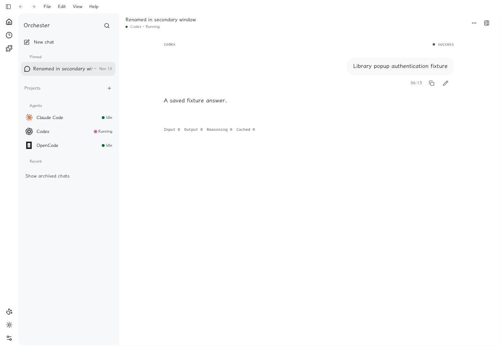
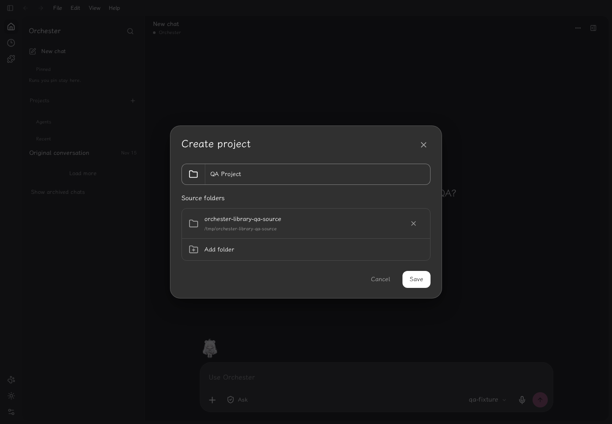
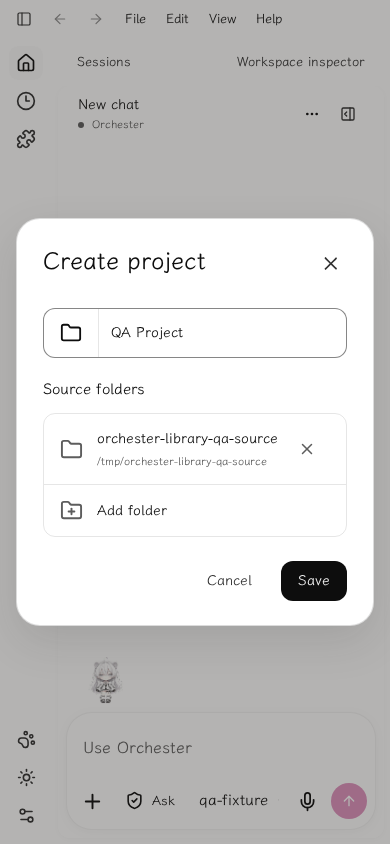
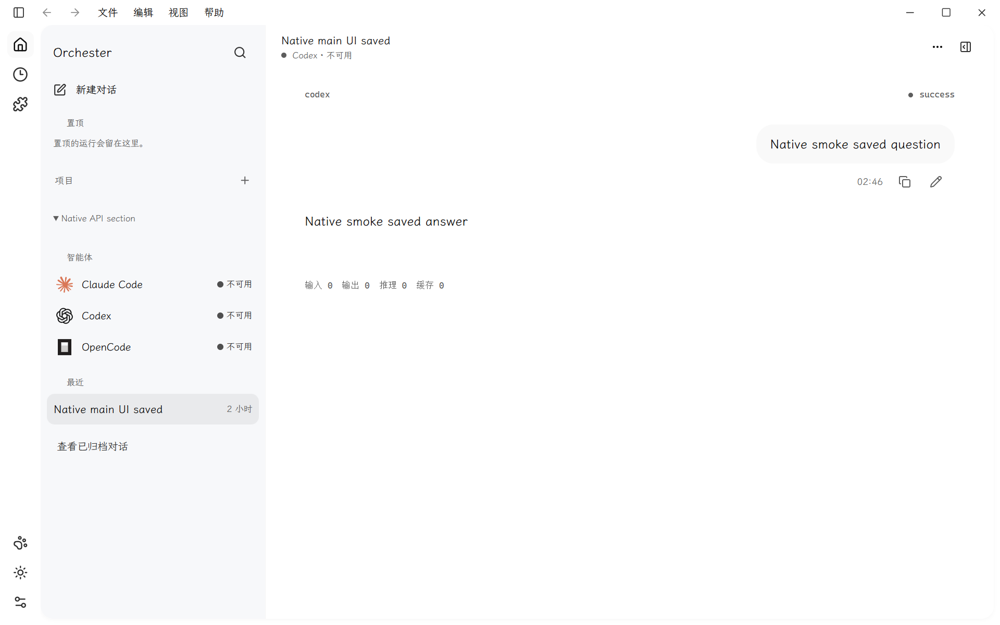
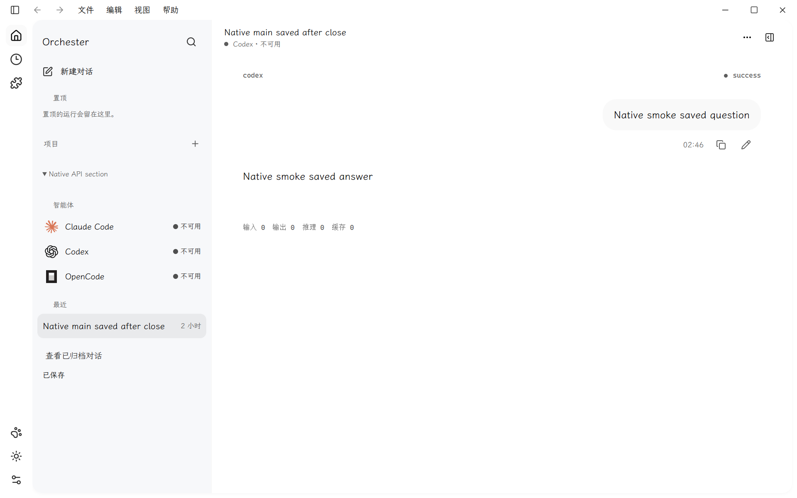

# 桌面项目库、会话操作与多窗口验收

日期：2026-11-10（Asia/Shanghai）。后端库持久化提交为 `db7f7be`，浏览器会话修复为 `14c7ea6`，Web 界面提交为 `0c52d5e`。此前参考与布局验收见 [桌面参考库](22-desktop-reference-library.md) 与 [导航恢复记录](23-desktop-recovery-acceptance.md)。

## 产品行为

项目编辑器支持名称和真实源目录，项目与分组由工作区 SQLite 保存。会话可重命名、置顶、标记未读、归档或恢复、移入项目或分组、复制本机链接和工作区目录、复制或下载 Markdown，并打开独立会话窗口。分组及归档属于阅读偏好，不删除源目录或会话原始内容。后端只接受已授权的 opaque 会话 ID；版本冲突返回 409，客户端重新读取并重放此次操作，保留另一窗口的改动。

侧栏空分类和无搜索结果时保留分页入口。旧 localStorage 置顶列表在历史加载后通过授权详情接口补齐；此前保存过项目也能迁移，暂时不可读取的 ID 保留以便后续重试。项目选择使用 ID，避免同名项目串接；名称和保存中的重复操作受校验约束。

发送中的消息立即出现在会话里，持久事件到达后替换临时消息；后续草稿仍留在队列。等待回复的提示支持减少动态效果。切换会话会丢弃旧请求的临时消息。

## 浏览器与后端

Web 全套测试通过：131 个测试文件、787 项测试；类型检查、production build 和设计间距门禁通过。另以隔离 fixture 检查深浅主题、390 px 项目编辑器、菜单操作、Markdown 代码围栏、打开窗口、刷新恢复、归档与分页；没有页面运行时错误。

真实 `EmbeddedServer` 双窗口测试使用独立状态目录、SQLite 和已保存的测试会话，通过真实 fragment/cookie/CSRF 流程操作，不调用模型。初版第二窗口 GET `/api/v1/session` 会换掉共享 Cookie，使主窗口仍持有的 CSRF 失效，保存返回 403。修复后有效会话 bootstrap 复用相同 Cookie、CSRF 与原到期时间；过期、撤销或未知 Cookie 不复用。存储仍只保留 token hash，原始 token 不进入 Debug 输出。

同一浏览器脚本复验：共享 Cookie 保持不变，主窗口保存为 200；两窗口的旧版本写入产生两次预期 409，重读后成功，最终同时保留子窗口重命名和主窗口置顶、未读状态。真实项目创建、关联、刷新和移除通过，源文件和历史内容逐字节不变。页面错误为 0。[真实结果记录](acceptance/desktop-library-auth-browser.json)

后端修复单独验证：`orchester-netz` 全目标 213 项测试通过、1 项 ignored，严格 Clippy 与格式检查通过。修复前新增 HTTP 回归稳定复现 403，修复后同一回归通过；最终 main 全工作区结果另行记录。

## 保留的截图

截图均已目视核对，仅包含隔离测试项目和会话。界面中的 Agent 活动状态来自只读发现，不代表本轮发起了对应模型调用。

## Windows 原生窗口

Windows x64 MSVC debug 包使用独立状态目录、WebView2 profile 和空工具 PATH，未请求模型调用。原生实测完成 16 项检查：实际创建第二和第三个 HWND、独立窗口原生标题栏、会话刷新恢复、拒绝其他 loopback origin 与浏览器弹出窗口、允许最小窗口控制并拒绝未授权 hide、关闭子窗口销毁 HWND/WebView、关闭主窗口隐藏而继续服务。七次主／子窗口写入均返回 200，旧版本冲突由界面重读恢复；共享 HttpOnly Cookie、CSRF 和到期时间保持不变。初版相同流程的主窗口保存为 403，修复后为 200。

验收记录保留 [16 项原生结果](acceptance/desktop-library-native-windows-result.json)、[源文件及二进制 SHA-256](acceptance/desktop-library-native-validation-source.json)。实测的原生 executable SHA-256 为 `372365d3241ce79b67a937d9f9f9c45a1007442466756d3f74ae61c11491b6d5`。2026-11-10 再次核对记录中全部八项源文件 hash 与当前工作树一致，当前 Web dist 的 33 项文件在隔离目录中均逐字节一致；隔离目录还保留 13 项旧构建的带 hash 文件，当前 index.html 不引用它们。随后重新运行当前源码的 Windows `cargo test --locked --manifest-path apps/desktop/src-tauri/Cargo.toml --target x86_64-pc-windows-msvc`，5 项通过；同一 package 严格 Clippy 和格式检查通过。使用 rustc/cargo 1.99.1 与 Visual Studio 18 Build Tools。

当前观察记录证明隔离主窗口关闭后，唯一保留 WebView 的健康接口仍为 200，保存的最终测试会话可读。[观察记录](acceptance/desktop-library-native-current-observation.json)。截图来自上述原生实测，未当作重新安装后的新截图：

隔离验收进程已按 executable 路径核对归属后结束，原生调试端口与嵌入服务端口均已释放。[清理记录](acceptance/desktop-library-native-cleanup.json)。

此记录覆盖 Windows 原生 debug 包与实际 HWND 生命周期；macOS/Linux 桌面原生安装包尚未在本轮验证。
